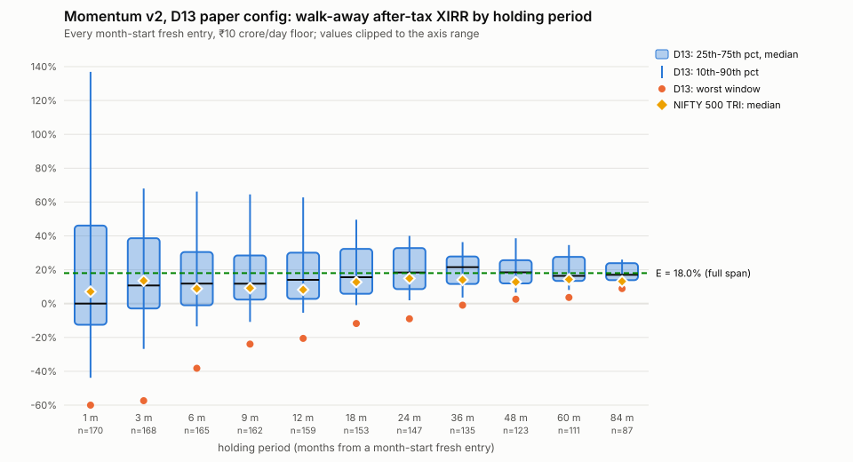
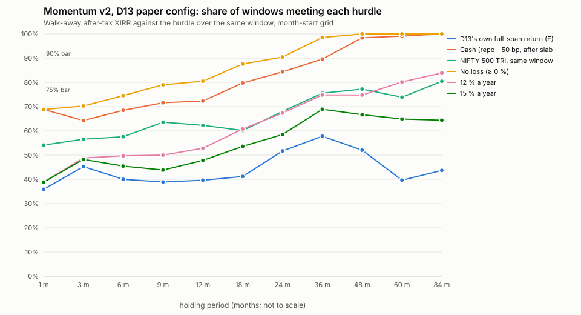

# How long must D13 be held? Holding-period study, 2026-10-19

Pre-registration: `ops/studies/preregistration-holding-period-2026-10-19.md`, committed at `e4a9e55` before
any run and unchanged since. Driver: `python -m backtest.holding_period` (`backtest/holding_period.py`).
Runs, cells and generated tables: `~/campaign/holding-period-c5f5cef/` (not committed). The generated
tables are copied into `holding-period-2026-10-19/tables.md`, and the charts sit beside them. Logs (times
in them are UTC): `~/campaign/holding-period-c5f5cef-2026-10-19.log` (baseline, named, both grids, render)
and `~/campaign/holding-period-c5f5cef-day8-2026-10-19.log` (day-8 grid and final render). Gate:
`~/campaign/holding-period-check*-2026-10-19.log`.

**Algorithm.** D13 only (`PAPER_RATIFIED_2026_09_06`). The P/E-timing study
(`ops/studies/pe-timing-2026-10-19.md`, branch `research/pe-timing`) gave every one of its 24 arms
**REJECT** under `backtest/decision_rule.py`. Under the pre-registered rule (§1), no second strategy is
run.

## Headline

All figures are the **walk-away after-tax XIRR**: exit at the end of the window, sale charged through the
shared cost model, deemed gains taxed (30 % slab, FY-end payment). Universe is the ₹10 crore/day liquidity
floor. Every window is a fresh start from cash on a month's first session. The span is 2012-07-04 →
2026-10-15. **E**, D13's own full-span walk-away return, is **18.0 %** a year. Over the same span the
NIFTY 500 TRI gave 12.9 % and cash 3.9 %, both after tax.

| To expect … | with 75 % confidence | with 90 % confidence | in every window (worst case) | Settled? |
|---|---|---|---|---|
| **not to lose money** | 9 months | **2 years** (21 months on the dense grid) | **4 years** | yes: every test agrees |
| **to beat cash** (repo − 50 bp, after tax) | 18 months | **3 years** on 2 of 3 start days, **4 years** on the 1st (§3) | 6 to 7 years | **not settled** at 36 m vs 48 m: the month-start grid sits at 89.6 % at 36 m |
| **to beat the NIFTY 500 TRI** over the same window | 7 years (≈ 75 % from 3 years on) | not within 7 years | not within 7 years | the 90 % answer ("never") holds on every grid |
| **12 % a year** | 5 years (≈ 75 % from 2½ years on) | not within 7 years | not within 7 years | the 90 % answer ("never") holds on every grid |
| **15 % a year** | not within 7 years (best: 69 % at 3 years) | not within 7 years | not within 7 years | yes |
| **D13's own long-run 18 %** | not within 7 years (best: 60 % at 3½ years) | not within 7 years | not within 7 years | yes |

In plain English:

- **No holding period in this data gives even a 75 % chance of earning D13's own long-run 18 %.**
  The chance peaks near 60 % at 2½–3½ years. It then *falls* to about 40 % at 5–7 years, because what
  a long window earns depends mostly on whether it contains the 2020–2024 boom (§5).
- **What you can expect with 90 % confidence is much less:** not losing money after about 2 years,
  beating cash after 3–4 years, and nothing better than that within 7 years. Since 2012, no fresh
  start held for 4 years or more ended with a loss after tax. The worst 4-year window still made
  +2.6 % a year.
- **The typical outcome is good but noisy.** The median walk-away return is 14 % a year at 1 year,
  18 % at 2, 21 % at 3, and 16–17 % at 5–7 years. D13 beat the NIFTY 500 TRI in about three windows
  out of four from 3 years on, by a median 2–5 pp a year.
- **When in the year you start does not matter.** The calendar month makes no detectable difference.
  Starting on the 15th instead of the 1st changes the median by under 1 pp beyond 3 months.
- **Going in and out costs money.** Every in/out pattern tested (3, 6 or 12 months in, then the same
  out, in either order) lost to staying invested in 71–99 % of windows, by a median 4–11 pp a year.

## 1. Data span, and why it is no longer

- **Span: 2012-07-04 → 2026-10-15** (3,537 sessions; 170 monthly starts from 2012-08). 2012-07-04 is
  the first session on which D13's whole look-back (12-1 momentum; the 365-day liquidity window) lies
  in joinable, ISIN-bearing L1, which starts 2011-06-22 (`backtest/windows.yaml`). 2026-10-15 is pinned
  so every run ends on the same session; the lake's last session, 2026-10-16, is kept as T+1 fill
  headroom.
- **Not earlier.** L1 reaches 2006, but the 2006 → 2011-06 rows come from bhavcopies with no ISIN.
  Names that died before 2011-06-22 have no ISIN witness, so ≈ 92,000 rows are quarantined, and
  corporate actions before 2011 are largely missing. A D13 universe there would be survivorship-biased,
  and extending L2 over it is held (M13.4). The L2 extension to ~2006 therefore does **not** make
  earlier starts honest.
- **Universe.** The runs use `turnover_floor` (₹ median-turnover floor only), which is survivorship-safe
  from 2011-06-22 and is what every fold study ran. The paper book screens NIFTY 500 point-in-time
  membership, which the lake now covers from **2015-03-28** (the pre-registration quoted 2016-10-24;
  the history has since been extended). Either date falls inside the span, so the choice stands.
  These figures are close to the paper book's, not identical. A nominal ₹10 crore/day floor is stricter
  in 2012 rupees, so early books draw on fewer names.
- **Independence — the caveat that matters most.** 170 overlapping monthly starts are not 170
  observations. The number of **non-overlapping** windows is 14 at 1 year, 7 at 2 years, 4 at 3 years,
  3 at 4 years, and **2 at 5 and 7 years**. Every probability table (in `tables.md`) carries a 90 %
  Wilson interval struck on that non-overlapping count. At 5–7 years those intervals run from ~10–40 %
  up to ~85–100 %. The long-horizon answers rest on **two or three independent market paths** — the
  2013–2019 stretch and the 2019–2026 one — and should be read as two or three stories, not as
  frequencies.

## 2. Baseline, and the frozen-D13 check

D13 was re-run on the fold test windows and the continuous 2016-09 → 2026-08 window at both floors, then
compared with the per-stock rebalance study's frozen D13 (lake through 2026-10-14):

- **6 of 8 runs are economically identical**: same NAV path, fills and figures. Only their digests
  moved, because the store's corporate-action calendar moved: dividends 30,736 → 30,643 and rights
  issues 840 → 841, with no code change.
- **F1 and the continuous window at ₹10 crore differ, and the cause is data drift.** One TCS dividend
  credit (INE467B01029, ₹92, 2018-10-23) is in the 2026-10-14 store and absent from today's. F1's 401
  fills are identical; it ends ₹96 lower (4.6007 % → 4.5977 % pre-tax). In the continuous run, cash
  differs by a few rupees from that day. The first fill difference comes a year later (2019-11-04: a
  buy of 20 shares instead of 21), and the run ends at 24.18 % against 24.14 %.
- This satisfies the pre-registered drift rule: the NAV diverges first at the moved credit, and no fill
  differs before it. **D13 was re-frozen on the current store**
  (`~/campaign/holding-period-c5f5cef/frozen-baseline.json`). The P/E study's stop on the same check
  had the same cause.
- Every one of the 592 runs (422 before the day-8 grid, then 170 more) used one store state.

## 3. Minimum holding period and stability

The full stability table is in `tables.md` ("Minimum holding period"). It holds the 90 % answer on the
month-start grid, on the dense horizons, on the mid-month and day-8 grids, on all grids pooled, and the
exact-vs-approximation comparison.

| Hurdle | 90 % horizon (month-start) | S1: other start days | S3: exact vs slice (pre-tax) | S4: dense horizons | Verdict |
|---|---|---|---|---|---|
| E (18.0 %) | not within 84 m | same | same | same | **stable** |
| Cash | 48 m | mid-month **36 m** · day-8 **36 m** · all three pooled **36 m** | 48 / 48 | 42 m (consistent) | **not stable** (S1), after the day-8 grid too |
| NIFTY 500 TRI | not within 84 m | same | **60 m / 84 m** | same | not stable (S3 only) |
| No loss | 24 m | 24 m | 18 / 18 | 21 m | **stable** |
| 12 % | not within 84 m | same | **84 m / not within 84 m** | same | not stable (S3 only) |
| 15 % | not within 84 m | same | same | same | **stable** |

What the instabilities mean:

- **Cash.** At 36 months, 121 of 135 month-start windows beat cash (89.6 %, just under the bar). On
  the mid-month grid, 36 months clears it. The honest answer is **"between 3 and 4 years"**: from
  42 months on, 97–100 % of windows on every grid beat cash. The pre-registered day-8 grid (§6 of the pre-registration) was run because of this. It gives 36 months (123 of 134 windows, 92 %), as do the mid-month grid and all three pooled. Only the month-start grid misses, by one window. The 90 % cash horizon therefore did not settle on one grid horizon: it is 36 months on two of three start days and 48 months on the third.
- **TRI and 12 %.** These fail only S3. S3 is a pre-tax test of whether slicing the one continuous run
  would have given the same answer as the fresh starts; it does not. On the after-tax figure the
  answer, "never at 90 % within 7 years", is the same on every grid. The disagreement is about the
  approximation, not the conclusion. §7 shows the slice is a biased stand-in.

## 4. The spread of outcomes by horizon (month-start grid)

| Horizon | Windows | Worst | 10th pct | Median | 90th pct | Best | Worst cumulative (start) | P(loss) | Median TRI | Median excess vs TRI |
|---|---|---|---|---|---|---|---|---|---|---|
| 1 m | 170 | −85.4 % | −43.8 % | 0.0 % | 136.9 % | 537.0 % | −12.4 % (2018-09-03) | 31 % | 7.1 % | +5.1 pp |
| 3 m | 168 | −57.4 % | −26.8 % | 10.7 % | 68.0 % | 360.9 % | −18.6 % (2018-09-03) | 30 % | 13.5 % | +2.8 pp |
| 6 m | 165 | −38.2 % | −13.4 % | 11.8 % | 66.2 % | 172.3 % | −21.0 % (2024-09-02) | 25 % | 8.8 % | +2.7 pp |
| 12 m | 159 | −20.6 % | −5.4 % | 14.0 % | 62.8 % | 105.3 % | −20.4 % (2018-09-03) | 19 % | 8.2 % | +3.5 pp |
| 18 m | 153 | −11.8 % | −0.9 % | 15.6 % | 49.5 % | 84.7 % | −17.1 % (2018-02-01) | 12 % | 12.7 % | +2.6 pp |
| 24 m | 147 | −9.0 % | 1.9 % | 18.4 % | 40.0 % | 61.1 % | −17.1 % (2018-05-02) | 10 % | 14.9 % | +3.4 pp |
| 36 m | 135 | −1.0 % | 3.6 % | 21.5 % | 36.4 % | 51.4 % | −2.8 % (2017-04-03) | 1 % | 14.0 % | +5.0 pp |
| 48 m | 123 | +2.6 % | 6.5 % | 18.5 % | 38.6 % | 48.6 % | +10.7 % (2015-08-03) | 0 % | 12.8 % | +3.7 pp |
| 60 m | 111 | +3.6 % | 8.0 % | 16.4 % | 34.6 % | 38.4 % | +19.4 % (2015-04-01) | 0 % | 14.3 % | +2.3 pp |
| 84 m | 87 | +8.9 % | 10.3 % | 17.0 % | 26.0 % | 27.3 % | +81.4 % (2013-01-01) | 0 % | 13.1 % | +3.4 pp |
| to span end | 170 | +2.3 % | 14.7 % | 20.5 % | 28.8 % | 57.0 % | +0.3 % (2026-09-01) | 0 % | 11.3 % | +10.4 pp |

XIRR is annualised, so very short windows swing to extremes: a −12 % month reads −85 %. The "worst
cumulative" column is what the money actually did. The worst windows cluster around **2018** (the
small/mid-cap bear and IL&FS) and **September 2024** (the peak before the 2025 correction). Within a
window, the worst drawdown was 33 % and the longest time under water was 1,086 days, about 3 years. A
3-year holder can sit through one full drawdown-and-recovery. Charts:

- 
- 

Probability that a fresh start meets each hurdle, month-start grid (full tables with 90 % intervals in
`tables.md`):

| Horizon | ≥ E (18.0 %) | ≥ cash | ≥ NIFTY 500 TRI | No loss | ≥ 12 % | ≥ 15 % |
|---|---|---|---|---|---|---|
| 1 m | 36 % | 69 % | 54 % | 69 % | 39 % | 39 % |
| 3 m | 45 % | 64 % | 57 % | 70 % | 49 % | 48 % |
| 6 m | 40 % | 68 % | 58 % | 75 % | 50 % | 45 % |
| 12 m | 40 % | 72 % | 62 % | 81 % | 53 % | 48 % |
| 18 m | 41 % | 80 % | 60 % | 88 % | 61 % | 54 % |
| 24 m | 52 % | 84 % | 68 % | 90 % | 67 % | 59 % |
| 36 m | 58 % | 90 %* | 76 % | 99 % | 75 % | 69 % |
| 48 m | 52 % | 98 % | 77 % | 100 % | 75 % | 67 % |
| 60 m | 40 % | 99 % | 74 % | 100 % | 80 % | 65 % |
| 84 m | 44 % | 100 % | 80 % | 100 % | 84 % | 64 % |

\* 89.6 % (121/135): just under the 90 % bar.

## 5. Named intervals (₹10 crore deciding, ₹1 crore for information)

Each interval is a fresh-start run with its own end date. "Regime-off share" is the share of sessions
on which D13's latest rebalance read the NIFTY 50 below its 200-session mean. While parked, A8's
**MIN_HOLDINGS** rail refuses sales below the minimum holding count, so part of the book stays
invested. This is the share of time *intended* in cash, not the cash weight. N34, for example, read
risk-off for 83 % of the time but held 8 names through September 2026 and gained.

| Key | Interval | Regime | Start → end | P/E at start | NIFTY 500 below high | D13 regime | **Walk-away after-tax** | Pre-tax | Max DD | Under water | TRI walk-away | vs TRI | vs cash | Trades | Charges | Regime-off share | ₹1 cr walk-away (info) |
|---|---|---|---|---|---|---|---|---|---|---|---|---|---|---|---|---|---|
| N01 | Full span | mixed | 2012-07-04 → 2026-10-15 | n/a | 19.2% | on | **18.0%** | 20.8% | 31.6% | 1086 d | 12.9% | +5.1 pp | +14.1 pp | 3287 | ₹322,160 | 22% | **n/a** |
| N02 | D13 decade (F1-F3 continuous) | mixed | 2016-09-01 → 2026-08-31 | 28.2 | 0.2% | on | **20.8%** | 24.2% | 29.9% | 1039 d | 12.4% | +8.4 pp | +17.3 pp | 2010 | ₹178,320 | 20% | **n/a** |
| N03 | Six-year window of the old ~23 % figures | mixed | 2019-07-01 → 2026-10-15 | 31.1 | 2.0% | on | **25.6%** | 30.3% | 19.9% | 292 d | 12.0% | +13.6 pp | +22.2 pp | 1523 | ₹135,684 | 26% | **23.4%** |
| N04 | First year of the span | sideways | 2012-07-04 → 2013-07-03 | n/a | 19.2% | on | **1.7%** | 2.7% | 13.1% | 180 d | 5.9% | -4.2 pp | -3.5 pp | 161 | ₹6,640 | 0% | **-11.0%** |
| N05 | Taper tantrum: Jan-2013 high to Aug-2013 low | bear | 2013-01-15 → 2013-08-28 | 18.8 | 6.3% | on | **-28.4%** | -28.1% | 18.8% | 225 d | -25.1% | -3.3 pp | -32.8 pp | 87 | ₹3,727 | 12% | **-27.6%** |
| N06 | Aug-2013 low, 12 months | recovery | 2013-08-28 → 2014-08-27 | 15.1 | 21.2% | OFF (parked) | **25.0%** | 29.5% | 6.9% | 59 d | 51.2% | -26.2 pp | +20.2 pp | 101 | ₹4,358 | 18% | **31.9%** |
| N07 | 2014 election year | bull | 2014-01-01 → 2014-12-31 | 19.0 | 4.0% | on | **29.9%** | 35.2% | 10.1% | 61 d | 33.0% | -3.1 pp | +25.0 pp | 123 | ₹5,011 | 0% | **42.0%** |
| N08 | Mar-2015 all-time high to Feb-2016 low | bear | 2015-03-03 → 2016-02-25 | 25.3 | 0.0% | on | **-3.3%** | -2.5% | 15.1% | 190 d | -20.7% | +17.4 pp | -7.7 pp | 51 | ₹3,015 | 49% | **-11.3%** |
| N09 | Mar-2015 all-time high, 24 months (flat) | sideways | 2015-03-03 → 2017-03-02 | 25.3 | 0.0% | on | **10.5%** | 12.7% | 15.5% | 348 d | 3.3% | +7.2 pp | +6.0 pp | 159 | ₹8,439 | 41% | **5.9%** |
| N10 | Feb-2016 low, 12 months | recovery | 2016-02-25 → 2017-02-23 | 20.5 | 20.1% | OFF (parked) | **22.0%** | 26.6% | 13.8% | 122 d | 28.9% | -6.9 pp | +18.1 pp | 83 | ₹4,453 | 34% | **15.2%** |
| N11 | Demonetisation, 3 months | crash | 2016-11-09 → 2017-02-08 | 26.2 | 5.0% | on | **9.3%** | 12.3% | 11.0% | 83 d | 16.8% | -7.4 pp | +5.6 pp | 45 | ₹2,359 | 33% | **6.1%** |
| N12 | Demonetisation, 12 months | bull | 2016-11-09 → 2017-11-08 | 26.2 | 5.0% | on | **18.3%** | 21.5% | 11.0% | 83 d | 23.0% | -4.7 pp | +14.4 pp | 164 | ₹7,758 | 8% | **49.4%** |
| N13 | 2017 bull year | bull | 2017-01-02 → 2017-12-29 | 25.5 | 8.2% | OFF (parked) | **27.5%** | 32.4% | 7.0% | 91 d | 31.7% | -4.2 pp | +23.8 pp | 156 | ₹7,135 | 8% | **55.4%** |
| N14 | 2018 small/mid-cap bear: Jan-2018 small-cap peak | bear | 2018-01-15 → 2019-08-30 | 32.9 | 0.0% | on | **-15.7%** | -15.4% | 26.3% | 592 d | -3.5% | -12.2 pp | -19.6 pp | 178 | ₹8,116 | 10% | **-18.6%** |
| N15 | Jan-2018 high, 24 months (flat broad market) | sideways | 2018-01-23 → 2020-01-17 | 33.2 | 0.0% | on | **-7.2%** | -6.8% | 25.4% | 724 d | 2.3% | -9.5 pp | -11.0 pp | 231 | ₹9,847 | 12% | **-8.0%** |
| N16 | IL&FS sell-off, 6 months | crash | 2018-09-21 → 2019-03-20 | 32.4 | 5.6% | on | **-16.8%** | -16.2% | 14.6% | 180 d | 2.1% | -18.9 pp | -20.5 pp | 84 | ₹4,126 | 16% | **-14.3%** |
| N17 | Aug-2018 all-time high, 12 months | bear | 2018-08-31 → 2019-08-30 | 34.5 | 0.0% | on | **-21.9%** | -21.6% | 22.6% | 364 d | -9.4% | -12.4 pp | -25.6 pp | 139 | ₹6,222 | 16% | **-20.7%** |
| N18 | COVID: from just before the peak, calendar 2020 | mixed | 2020-01-01 → 2020-12-31 | 30.9 | 0.4% | on | **20.2%** | 24.3% | 19.6% | 172 d | 14.6% | +5.7 pp | +17.7 pp | 102 | ₹4,780 | 41% | **41.4%** |
| N19 | COVID: at the Jan-2020 peak, 3 months | crash | 2020-01-17 → 2020-04-16 | 31.5 | 0.0% | on | **-23.3%** | -22.8% | 16.5% | 56 d | -71.7% | +48.4 pp | -26.0 pp | 31 | ₹1,782 | 48% | **-31.7%** |
| N20 | COVID: at the Jan-2020 peak, 24 months | mixed | 2020-01-17 → 2022-01-17 | 31.5 | 0.0% | on | **42.1%** | 47.6% | 16.5% | 166 d | 23.9% | +18.2 pp | +39.6 pp | 243 | ₹14,145 | 21% | **50.2%** |
| N21 | COVID: at the Mar-2020 trough, 3 months | recovery | 2020-03-23 → 2020-06-22 | 19.4 | 38.1% | OFF (parked) | **2.1%** | 3.0% | 0.0% | 0 d | 216.2% | -214.1 pp | -0.0 pp | 0 | ₹0 | 100% | **2.1%** |
| N22 | COVID: at the Mar-2020 trough, 12 months | recovery | 2020-03-23 → 2021-03-22 | 19.4 | 38.1% | OFF (parked) | **43.1%** | 51.6% | 5.8% | 48 d | 83.6% | -40.5 pp | +40.7 pp | 84 | ₹4,227 | 36% | **48.5%** |
| N23 | COVID: in the recovery, Jun-2020, 12 months | recovery | 2020-06-01 → 2021-05-31 | 25.9 | 20.4% | OFF (parked) | **69.7%** | 78.8% | 5.8% | 48 d | 59.0% | +10.7 pp | +67.5 pp | 102 | ₹5,420 | 18% | **67.4%** |
| N24 | 2021 bull run to the Oct-2021 high | bull | 2021-01-01 → 2021-10-18 | 44.5 | 0.0% | on | **94.6%** | 108.7% | 5.1% | 37 d | 42.8% | +51.8 pp | +92.3 pp | 89 | ₹5,412 | 0% | **46.1%** |
| N25 | Oct-2021 all-time high, 12 months | bear | 2021-10-18 → 2022-10-17 | 29.5 | 0.0% | on | **0.8%** | 1.6% | 18.0% | 323 d | -5.4% | +6.2 pp | -1.8 pp | 177 | ₹7,722 | 34% | **8.8%** |
| N26 | 2022: sideways, rate hikes | sideways | 2022-01-03 → 2022-12-30 | 25.8 | 4.1% | on | **7.1%** | 8.9% | 13.8% | 221 d | 2.0% | +5.1 pp | +4.3 pp | 144 | ₹7,094 | 34% | **4.0%** |
| N27 | Jun-2022 low, 12 months | recovery | 2022-06-20 → 2023-06-19 | 19.4 | 17.8% | OFF (parked) | **18.7%** | 22.4% | 16.6% | 189 d | 21.9% | -3.3 pp | +15.0 pp | 135 | ₹6,916 | 19% | **21.6%** |
| N28 | 2023-24 small-cap melt-up: Mar-2023 low to Sep-2024 peak | bull | 2023-03-28 → 2024-09-26 | 20.8 | 11.1% | OFF (parked) | **73.2%** | 87.4% | 17.5% | 76 d | 41.0% | +32.2 pp | +69.1 pp | 261 | ₹19,073 | 5% | **57.7%** |
| N29 | Sep-2024 all-time high to Feb-2025 low | bear | 2024-09-26 → 2025-02-28 | 28.0 | 0.0% | on | **-37.3%** | -37.0% | 18.9% | 135 d | -39.0% | +1.7 pp | -40.7 pp | 57 | ₹3,187 | 40% | **-32.2%** |
| N30 | Sep-2024 all-time high, 12 months | bear | 2024-09-26 → 2025-09-25 | 28.0 | 0.0% | on | **-2.0%** | -1.5% | 18.9% | 293 d | -5.5% | +3.4 pp | -5.7 pp | 151 | ₹7,059 | 33% | **4.8%** |
| N31 | Sep-2024 all-time high to span end | mixed | 2024-09-26 → 2026-10-15 | 28.0 | 0.0% | on | **7.4%** | 8.4% | 18.9% | 293 d | -4.0% | +11.4 pp | +3.8 pp | 260 | ₹12,585 | 46% | **12.7%** |
| N32 | Feb-2025 low, 12 months | recovery | 2025-02-28 → 2026-02-27 | 21.8 | 18.6% | OFF (parked) | **13.9%** | 18.0% | 9.9% | 58 d | 13.6% | +0.4 pp | +10.6 pp | 150 | ₹8,910 | 24% | **17.2%** |
| N33 | Latest year | mixed | 2025-10-15 → 2026-10-15 | 24.5 | 3.6% | on | **11.1%** | 14.2% | 12.9% | 237 d | -4.6% | +15.7 pp | +7.8 pp | 107 | ₹5,346 | 62% | **12.2%** |
| N34 | Latest 6 months | mixed | 2026-04-15 → 2026-10-15 | 23.4 | 6.6% | OFF (parked) | **21.6%** | 27.7% | 2.1% | 14 d | -3.2% | +24.8 pp | +18.5 pp | 26 | ₹1,782 | 83% | **15.5%** |
| N35 | Latest 3 months | mixed | 2026-07-15 → 2026-10-15 | 23.0 | 3.4% | OFF (parked) | **43.7%** | 55.6% | 2.1% | 14 d | -17.8% | +61.5 pp | +40.9 pp | 26 | ₹1,767 | 68% | **29.3%** |
| N36 | First 7 years of the span | mixed | 2012-07-04 → 2019-07-03 | n/a | 19.2% | on | **11.6%** | 13.5% | 26.9% | 538 d | 14.0% | -2.4 pp | +7.0 pp | 928 | ₹60,507 | 16% | **n/a** |
| N37 | Mar-2015 all-time high, 5 years | mixed | 2015-03-03 → 2020-03-02 | 25.3 | 0.0% | on | **5.5%** | 7.0% | 25.8% | 781 d | 5.7% | -0.2 pp | +1.4 pp | 578 | ₹31,676 | 21% | **n/a** |
| N38 | COVID peak, 5 years | mixed | 2020-01-17 → 2025-01-16 | 31.5 | 0.0% | on | **34.0%** | 39.4% | 18.5% | 221 d | 16.1% | +18.0 pp | +30.7 pp | 1010 | ₹86,007 | 17% | **35.3%** |
| N39 | COVID trough, 5 years | mixed | 2020-03-23 → 2025-03-21 | 19.4 | 38.1% | OFF (parked) | **33.0%** | 38.6% | 18.4% | 227 d | 26.6% | +6.4 pp | +29.6 pp | 949 | ₹84,033 | 20% | **31.7%** |
| N40 | 2017-2021, 5 years | mixed | 2017-01-02 → 2021-12-31 | 25.5 | 8.2% | OFF (parked) | **16.7%** | 19.0% | 30.9% | 1058 d | 16.9% | -0.2 pp | +13.4 pp | 655 | ₹34,723 | 15% | **n/a** |

What the named intervals show:

- **Starting into a fall hurts early, and recovers with time.** Starting at the COVID peak lost
  −23 % a year over 3 months (N19). Held 2 years from the same start, it made **+42 %** a year (N20),
  and 5 years, **+34 %** (N38). Starting at the Sep-2024 high: −37 % to the Feb-2025 low (N29), −2 %
  after a year (N30), **+7 %** a year to the span end (N31).
- **The 2018 small/mid-cap bear is the worst place to have started.** From the Jan-2018 small-cap
  peak: −16 % a year over 19½ months (N14). The flat 2018–19 broad market: −7 % a year over 2 years
  (N15). IL&FS: −17 % over 6 months (N16). D13 trailed the TRI by 9–19 pp a year through that stretch,
  because the momentum names were the small/mid caps that fell.
- **Starting at the trough is no free lunch for D13.** At the COVID low (N21) the regime read risk-off,
  so the book sat in cash for 3 months while the TRI rose ~216 % annualised. Over 12 months it still
  made +43 % (N22), against the TRI's +84 %.
- **Bull runs are where the edge is made:** 2021 at +95 % annualised (N24), the 2023–24 melt-up at +73 %
  (N28), the June-2020 recovery at +70 % (N23).
- **Sideways years are thin:** 2022 at +7 % (N26), the 2015–17 flat stretch at +10 % (N09).

## 6. Era, not horizon, decides the long windows (post hoc, descriptive)

*Added after seeing the results.* Median walk-away XIRR, with the windows meeting E, by start year,
month-start grid:

| Start year | 12 m | 36 m | 60 m | 84 m |
|---|---|---|---|---|
| 2013 | 17 % (5/12) | 18 % (5/12) | 17 % (4/12) | 11 % (0/12) |
| 2014 | 35 % (10/12) | 18 % (7/12) | 11 % (0/12) | 16 % (0/12) |
| 2015 | 7 % (2/12) | 13 % (1/12) | 7 % (0/12) | 15 % (0/12) |
| 2016 | 16 % (5/12) | 7 % (0/12) | 15 % (0/12) | 16 % (4/12) |
| 2017 | 15 % (3/12) | 3 % (0/12) | 15 % (0/12) | 24 % (12/12) |
| 2018 | −10 % (0/12) | 17 % (5/12) | 16 % (6/12) | 24 % (12/12) |
| 2019 | 5 % (1/12) | 26 % (12/12) | 35 % (12/12) | 26 % (10/10) |
| 2020 | 65 % (11/12) | 28 % (12/12) | 34 % (12/12) | — |
| 2021 | 15 % (5/12) | 37 % (12/12) | 24 % (10/10) | — |
| 2022 | 15 % (6/12) | 30 % (12/12) | — | — |
| 2023 | 82 % (12/12) | 28 % (10/10) | — | — |

A 5-year window that contains the whole June-2020 → September-2024 stretch reached E every time (9 of 9,
median 34 %). Windows that do not contain it reached E 35 times in 102 (median 16 %). The long-run 18 %
is an average over one weak era (2013–2019, roughly 7–17 % a year) and one exceptional one. Holding
longer does not by itself pull the outcome toward 18 %.

## 7. Exact fresh starts vs slicing the continuous run

Slicing the full-span run's NAV, as if bought at S's close, is **not** a good stand-in for a fresh start:

- **Noisy below a year:** the mean absolute gap is 26 pp of XIRR at 1 month and 4 pp at 12 months.
- **Biased at long horizons:** fresh starts beat the slice by a median **1.1–1.3 pp a year** at 48–84
  months, and the slice is higher in only 10–20 % of those windows. A fresh book buys the current top
  20 at once. A continuing book carries holdings bought months earlier that have not yet fallen out of
  the top 30.

The study therefore reads exact replays for every cell. The exact-grid claim — a run to the span end
holds the same NAV and fills as a run to any earlier date — was **verified on 11 windows, with 0 NAV
points differing, identical fill counts and a 0.00 bp gap** (`tables.md`, "Validation").

## 8. Start month, start day

- **Calendar month:** at 12 months the monthly medians range from 6.7 % (July) to 19.3 % (January); at
  36 months, from 18.2 % to 24.2 %. With 13 windows per month, one per year, that spread is noise. The
  pre-registered permutation test gives p = 0.96 (12 m) and 1.00 (36 m). Those values are high partly
  because adjacent-month windows overlap, so the test cannot detect a modest effect either. No month
  stands out on worst case or on P(≥ TRI).
- **Day of month:** starting on the first session on or after the 15th instead of the 1st changes the
  paired median by +2.2 pp at 1 month, +0.7 pp at 3 months, and |≤ 0.7| pp from 6 months on. The
  probabilities track within a few points at every horizon (`tables.md`). The day-8 grid (every month's first session on or after the 8th) agrees: paired median differences against the month-start grid are +3.2 pp at 1 month, +1.8 pp at 3 months and ≤ 0.7 pp from 6 months on. Its medians are 14.2 % at 12 months, 21.3 % at 36 and 16.6 % at 60, against 14.0 %, 21.5 % and 16.4 % on the month-start grid.

## 9. In and out vs staying invested; SIP vs lump sum

| Pattern | Over 24 m: in/out beats staying | 36 m | 60 m | Median cost a year |
|---|---|---|---|---|
| 3 m in / 3 m out (either order) | 16 % | 4–7 % | 1–2 % | 9–11 pp |
| 6 m in / 6 m out | 19–21 % | 7–10 % | 1–2 % | 7–9 pp |
| 12 m in / 12 m out | 20–29 % | 13–19 % | 4–12 % | 4–9 pp |

Each invested leg is a fresh start (exit, charges and tax at the end of every leg); each out leg earns
after-tax cash. Half the time in cash forfeits about half the return, and the round trips add costs and
reset D13's momentum book. Stopping and restarting did not even protect the worst case consistently.

**Monthly SIP vs lump sum** (pre-tax, SIP as units of the fresh-start run's NAV — the replay engine takes
one deposit, so this is a stated approximation):

| Horizon | D13 lump sum: median / worst | D13 SIP: median / worst | SIP beats lump sum | TRI lump / SIP median |
|---|---|---|---|---|
| 12 m | 17.4 % / −20.2 % | 14.6 % / −24.0 % | 53 % | 10.2 % / 11.4 % |
| 36 m | 24.4 % / −0.1 % | 22.0 % / −6.6 % | 44 % | 14.9 % / 15.1 % |
| 60 m | 18.6 % / +5.3 % | 23.9 % / +0.3 % | 56 % | 14.8 % / 15.6 % |

A SIP is roughly a coin flip against a lump sum on rate of return. Its worst case is not better, because
the later instalments carry the most money into whatever the market does last.

## 10. What this means for someone investing today

- **The start today is a parked one.** On 2026-10-15 the NIFTY 50 is below its 200-session mean, so D13
  reads risk-off. A fresh book would stay mostly in cash until a monthly rebalance reads risk-on, and the
  first months would earn little either way (N33–N35). The NIFTY 500 is 7 % below its Sep-2024 high, at
  a P/E of 21.9.
- **Plan for at least 2 years, and preferably 4.** In 14 years of data, a fresh start held for 2 years
  avoided a loss 90 % of the time. Held for 4 years or more, it never lost money after tax. It beat cash
  in 97–100 % of windows from 3½ years on.
- **Do not plan on 18 %.** That is the long-run average across one weak and one exceptional era. The
  median 5–7-year outcome was 16–17 % a year. The 10th percentile was 8–10 %, and in the weak era 7–15 %
  was normal. D13 beat the NIFTY 500 TRI over most 3-year-plus windows, but not with 90 % confidence
  at any horizon.
- **Don't time it:** neither the start month, the start day, nor stepping in and out helped.

## 11. Fixes, deviations and caveats

- **A solver fix during the study.** The tax layer's XIRR cannot solve a stream with a deep short-window
  loss and a tax paid after the terminal value. `backtest/xirr.py` documents this two-root case. The
  NIFTY 500 TRI over N19 came back blank on the first render. Leaving such cells unscored would drop the
  worst windows, so they are now solved for the highest root of the same flows
  (`holding_period_stats.highest_root`, commit `79543e9`). No definition changed.
- **Withheld cells.** 7 mid-month cells (one start, 2017-05-15) and 7 day-8 cells (one start, 2017-05-08) have no walk-away figure: a reissued
  ISIN (INE353G01020) lacks the Sec 55(2)(ac) grandfathering price, so the tax layer withholds the deemed
  sale. As pre-registered, they are counted, not scored. At ₹1 crore (information only), five long named
  runs (N01, N02, N36, N37, N40) are withheld for the same reason.
- **Walk-away, not realised, is the primary figure.** The realised figure, the decision rule's, is
  reported beside it. The two are close over long windows (18.0 % vs 18.1 % on the full span). Over 1
  year, walk-away is lower because it charges the deferred STCG.
- **TRI comparison detail.** The TRI is held as an index ETF with 0.1 % slippage a side. D13's fills
  carry the cost model only (the engine's convention). D13 enters a session later than the TRI, because
  it decides at the first close and fills the next.
- **SIP** is a unitised approximation, pre-tax (§9). **In/out** folds each leg's FY-end tax into its
  XIRR.
- **₹1 crore/day** was run for the named intervals only, as information. The grids are ₹10 crore only.
- The universe is `turnover_floor`, not the paper book's NIFTY 500 screen (§1).

## 12. Follow-ups (post hoc, not run)

- Repeat the grid on the `nifty500` universe from 2015-03-28, now that PIT membership reaches there, so
  that the paper book's own screen is measured.
- A within-year test of the start-month effect (paired by year) instead of the plain permutation.
- A real per-instalment SIP replay, which needs a multi-deposit runner.
